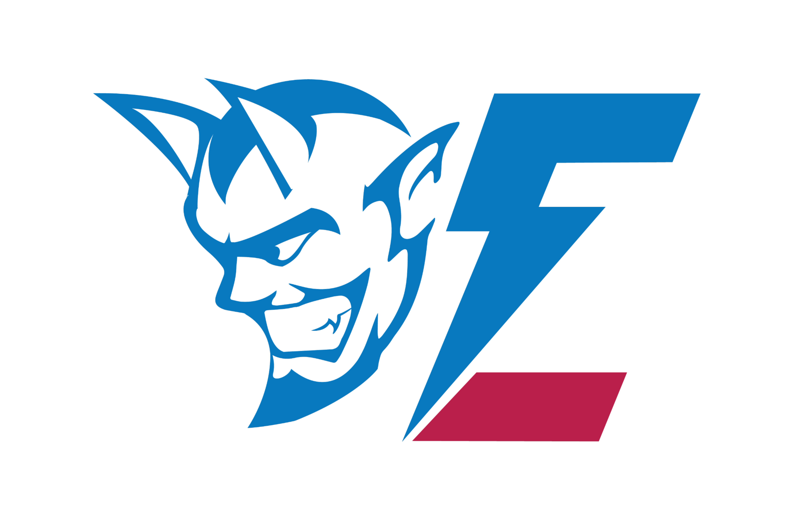
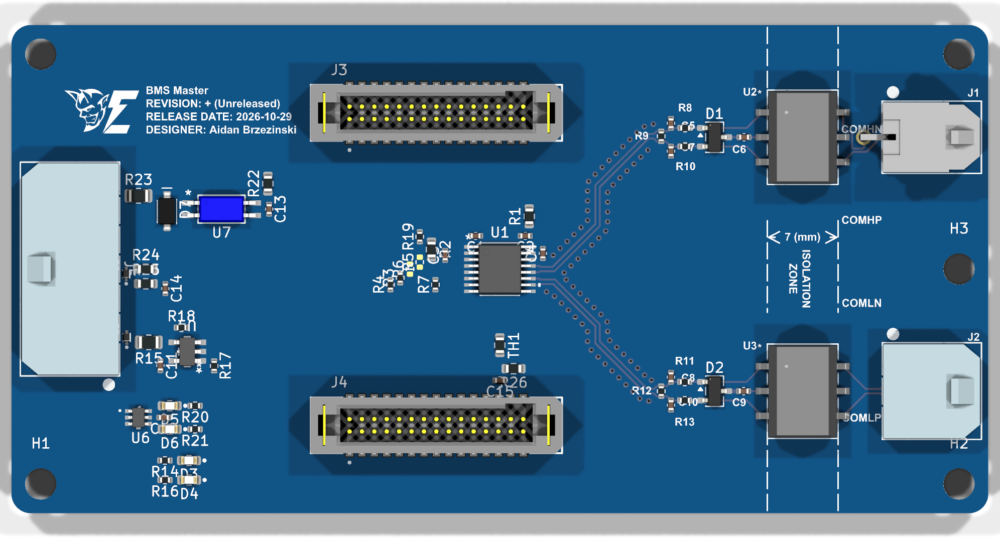
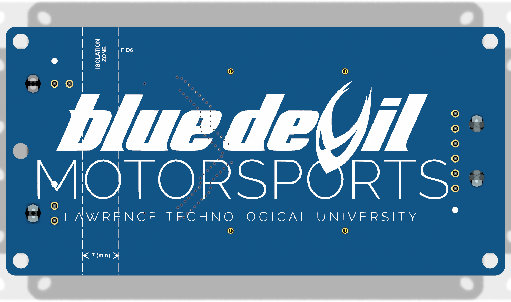

  

<h1 align="center">BMS_MASTER</h1>

BMS Master

<em>The BMS master board is the bridge between the TIM and the 16 BMS slave boards. It passes data both ways over a looped daisy chain, isolated by transformers so the battery’s high voltage never reaches the low-voltage side, and it signals the TIM the moment any slave reports a fault.</em>

  

    

***

  
&nbsp; &nbsp; &nbsp; &nbsp;
  

***

## SPECIFICATIONS

| Parameter | Value |
| --- | --- |
| Dimensions | 100.0 × 50.0 mm |
| Company | Blue Devil Motor Sports |
| Designer | Aidan Brzezinski |
| Revision | + (Unreleased) |
